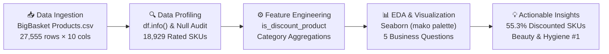

# bigbasket-products-analysis
Exploratory Data Analysis (EDA) of 27,555 BigBasket e-commerce products (₹8.89M catalog value) using Python, Pandas, Matplotlib &amp; Seaborn — uncovering top categories, high-rated SKUs (≥4.0★), and discounted vs. original-price performance (55.3% discounted).
# 🛒 BigBasket Products — Exploratory Data Analysis (EDA)

## 📌 Project Overview

This **Python Exploratory Data Analysis (EDA)** project investigates **27,555 e-commerce grocery product listings** from **BigBasket**, India's leading online supermarket. Using **Pandas**, **NumPy**, **Matplotlib**, and **Seaborn**, the analysis uncovers top-listed and niche products, evaluates category volume versus revenue value across **11 product categories**, filters high-rated inventory ($\ge 4.0$ stars), and engineers pricing features to compare **discounted** versus **original-price** products.

## 🔄 Data Analysis Pipeline


> *Note: Make sure your exported pipeline image is named `bigbasket_pipeline.png` in the repository root, or rely on the interactive Mermaid diagram below which renders natively on GitHub.*



## 🎯 Key Dataset Metrics & KPIs

| Metric | Value | Description |
| :--- | :---: | :--- |
| **Total Product Listings** | **27,555** | Total SKU entries across the BigBasket catalog. |
| **Product Categories** | **11** | Distinct top-level grocery & household categories. |
| **Total Catalog Sale Value** | **₹8,886,895.53** | Sum of `sale_price` across all 27,555 product listings. |
| **High-Rated Products ($\ge 4.0$)** | **12,354** | **65.26%** of all rated products (`18,929`) and **44.83%** of the entire catalog. |
| **Discounted Products** | **15,229 (55.27%)** | Products where `sale_price < market_price`, driving **56.17%** of total value. |
| **Original-Price Products** | **12,326 (44.73%)** | Products sold at full market price, driving **43.83%** of total value. |

## 📈 Analysis Breakdown & Key Insights

### 1. Top 10 Most Frequent Product Listings
Staple cooking ingredients dominate product listing frequency, with **Foodgrains, Oil & Masala** claiming **5 of the top 10** spots:

| Rank | Product | Category | Count |
| :---: | :--- | :--- | :---: |
| 1 | **Turmeric Powder/Arisina Pudi** | Foodgrains, Oil & Masala | **26** |
| 2 | **Extra Virgin Olive Oil** | Gourmet & World Food | **14** |
| 3 | **Cow Ghee/Tuppa** | Foodgrains, Oil & Masala | **14** |
| 4 | **Soft Drink** | Beverages | **12** |
| 5 | **Colorsilk Hair Colour With Keratin** | Beauty & Hygiene | **12** |
| 6 | **Coriander Powder** | Foodgrains, Oil & Masala | **11** |
| 7 | **Ghee/Tuppa** | Foodgrains, Oil & Masala | **11** |
| 8 | **Powder - Coriander** | Foodgrains, Oil & Masala | **11** |
| 9 | **Olive Oil - Extra Virgin** | Gourmet & World Food | **11** |
| 10 | **Hand Sanitizer** | Beauty & Hygiene | **10** |

* **Catalog Standardization Opportunity:** Naming inversions such as `Coriander Powder` vs. `Powder - Coriander` and `Extra Virgin Olive Oil` vs. `Olive Oil - Extra Virgin` split identical products across separate entries—standardizing SKU naming would improve search relevance and inventory tracking.

### 2. Least Frequent Products (`Count = 1`)
Long-tail, single-listing items appear primarily in specialized niches within **Cleaning & Household** (e.g., `Geometry Box` variants), **Beauty & Hygiene** (e.g., `Genuine Wood Shaving Brush`, `Gentleman Urbane` fragrances), and **Snacks & Branded Foods** (`pasta shell`).

### 3. Category Performance — Product Count vs. Total Sale Value

| Category | Product Count | Share of Catalog | Total Sale Value (₹) | Share of Value | Avg. Price (₹) |
| :--- | :---: | :---: | :---: | :---: | :---: |
| **Beauty & Hygiene** | **7,867** | **28.55%** | **3,293,749.24** | **37.06%** | 418.68 |
| **Kitchen, Garden & Pets** | 3,580 | 12.99% | **1,816,938.12** | **20.45%** | 507.52 |
| **Gourmet & World Food** | 4,690 | 17.02% | 1,500,115.31 | 16.88% | 319.85 |
| **Cleaning & Household** | 2,675 | 9.71% | 605,013.09 | 6.81% | 226.17 |
| **Foodgrains, Oil & Masala** | 2,676 | 9.71% | 516,916.23 | 5.82% | 193.17 |
| **Snacks & Branded Foods** | 2,814 | 10.21% | 364,675.08 | 4.10% | 129.59 |
| **Baby Care** | 610 | 2.21% | 326,317.17 | 3.67% | **534.95** |
| **Beverages** | 885 | 3.21% | 212,186.67 | 2.39% | 239.76 |
| **Bakery, Cakes & Dairy** | 851 | 3.09% | 121,525.14 | 1.37% | 142.80 |
| **Eggs, Meat & Fish** | 350 | 1.27% | 101,114.12 | 1.14% | 288.90 |
| **Fruits & Vegetables** | 557 | 2.02% | 28,345.36 | 0.32% | 50.89 |

* **Top Category Leader:** **Beauty & Hygiene** leads decisively in both listing volume (**28.55%**) and total sale value (**37.06%**).
* **High-Ticket Outperformers:** **Kitchen, Garden & Pets** ranks 3rd in SKU count (`3,580`) but jumps to **2nd in total sale value** (`₹1.82M`, averaging `₹507.52`/item). Similarly, **Baby Care** has the highest average item price (`₹534.95`) despite representing only `2.21%` of catalog count.

### 4. Customer Ratings Analysis ($\ge 4.0$ Stars)
* Out of **27,555** total listings, **18,929** carry customer ratings (**8,626** or **31.3%** are unrated).
* **12,354 products** achieve a rating of **4.0 or higher** (**65.26%** of rated items), signaling strong perceived product quality across core categories.

### 5. Discounted vs. Original-Price Products

Using an engineered boolean feature (`is_discount_product = market_price - sale_price != 0`):

| Pricing Segment | Product Count | Count % | Total Sale Value (₹) | Value % | Mean Price (₹) | Median Price (₹) |
| :--- | :---: | :---: | :---: | :---: | :---: | :---: |
| **Discounted (`True`)** | **15,229** | **55.27%** | **4,991,869.18** | **56.17%** | **327.79** | 191.04 |
| **Original Price (`False`)** | 12,326 | 44.73% | 3,895,026.35 | 43.83% | 316.00 | 190.00 |

* **Discount-Driven Catalog:** More than half of BigBasket's catalog (**55.27%**) is actively discounted, and discounted items command a slightly higher mean selling price (`₹327.79` vs. `₹316.00`), indicating promotions are frequently applied to mid-to-high-ticket items to boost conversion.

## 💡 Business Recommendations

1. **Prioritize High-Value Categories:** Double down on merchandising and cross-selling within **Beauty & Hygiene**, **Kitchen, Garden & Pets**, and **Gourmet & World Food**, which together generate **74.39%** of total catalog sale value.
2. **Standardize Product Naming Taxonomy:** Normalize inverted titles (e.g., `Coriander Powder` vs. `Powder - Coriander`) to prevent catalog fragmentation and enhance on-site search accuracy.
3. **Close the 31.3% Rating Gap:** Trigger post-delivery review prompts for the **8,626 unrated products**—social proof directly lifts conversion rates for e-commerce SKUs.
4. **Optimize Promotional Margin Mix:** Since **55.27%** of SKUs are already discounted, test targeted bundle discounts on high-margin categories (**Baby Care**, **Kitchen, Garden & Pets**) rather than blanket markdowns.

## 🛠️ Tech Stack

* **Language:** Python 3
* **Data Manipulation:** Pandas, NumPy
* **Visualization:** Matplotlib, Seaborn (`mako` palette)
* **Environment:** Jupyter Notebook

## 📂 Project Structure

```text
bigbasket-products-analysis/
├── bigbasket_analysis.ipynb     # Complete EDA & visualization notebook
├── BigBasket Products.csv       # Raw dataset (27,555 product listings)
├── bigbasket_pipeline.png       # Visual data analysis pipeline diagram
└── README.md                    # Project documentation
```

## 🚀 How to Run Locally

1. Clone this repository:
```bash
git clone https://github.com/me4094163-code/bigbasket-products-analysis.git
cd bigbasket-products-analysis
```
2. Install the required libraries:
```bash
pip install pandas numpy matplotlib seaborn jupyter
```
3. Launch Jupyter Notebook and open `bigbasket_analysis.ipynb`:
```bash
jupyter notebook
```

## 📬 Contact

Created by **Mohamed Essam** – feel free to connect!

* **LinkedIn:** [Mohamed Essam](https://www.linkedin.com/in/mohamed-essam-009a2132a)
* **GitHub:** [me4094163-code](https://github.com/me4094163-code)
* **Email:** [Me4094163@gmail.com](mailto:Me4094163@gmail.com)
* 
